# کوریدور | Quoridor

[English](README.md) · فارسی · [نسخهٔ وب و Pages](WEB.md) · [راهنمای اندروید](ANDROID.md) · [بازی آنلاین و میزبانی](ONLINE.md) · [راهنمای مشارکت](CONTRIBUTING.md) · [راهنمای انتشار](RELEASING.md) · [تغییرات نسخه‌ها](CHANGELOG.md)

کوریدور یک بازی رومیزی استراتژی برای **وب، اندروید و دسکتاپ** است. **[همین حالا در مرورگر بازی کنید](https://salehghotbani.github.io/Game-Quoridor/)**؛ نصب لازم نیست. با پنج تمرین تصویری کوتاه بازی را یاد بگیرید و پیش از حریفان به لبهٔ مقابل برسید. بازی محلی **دو و چهارنفری** و ربات سه‌سطحی در همهٔ نسخه‌ها وجود دارد؛ بازی آنلاین فعلاً در اندروید و دسکتاپ ارائه می‌شود و بخش اتصال به سرور از وب حذف شده است. منطق و ذخیره‌های مرورگر با Java آزمایش تطبیقی می‌شوند.

نسخهٔ دسکتاپ و سرور فقط از کتابخانهٔ استاندارد Java استفاده می‌کنند. کتابخانهٔ سازگاری Java برای Android همراه APK و [مجوزهای آن](THIRD_PARTY_NOTICES.md) توزیع می‌شود.

## تصاویر واقعی بازی

تصاویر زیر از اجرای همین برنامه گرفته شده‌اند.

| آموزش تصویری · وب | آموزش تصویری · اندروید |
| --- | --- |
| [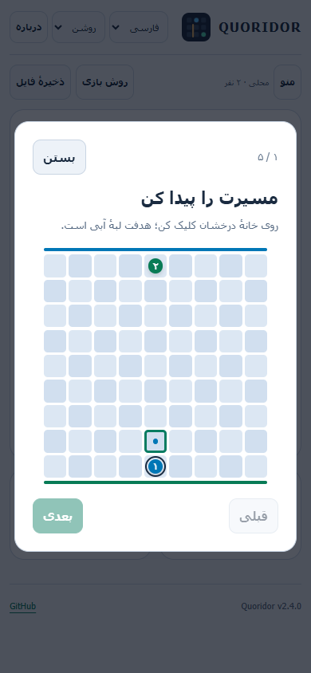](docs/screenshots/web-tutorial-fa-light.png) | [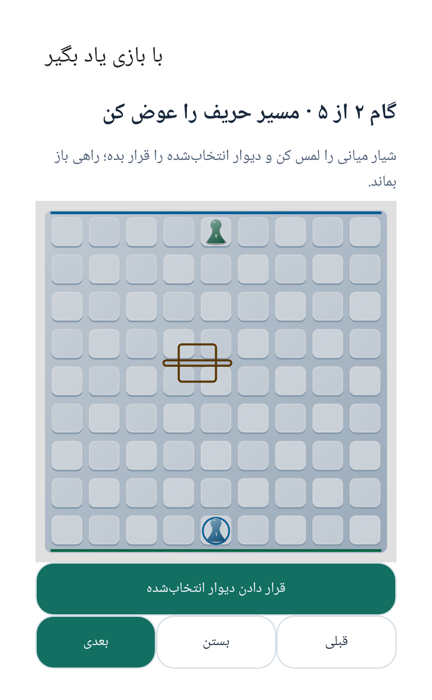](docs/screenshots/android-tutorial-fa-light.png) |
| **آموزش تصویری · دسکتاپ** | **شروع دوباره پس از برد · وب** |
| [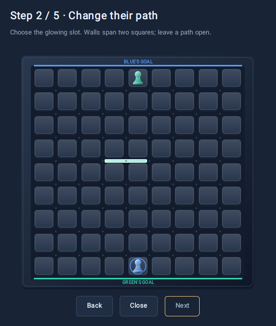](docs/screenshots/tutorial-en-dark.png) | [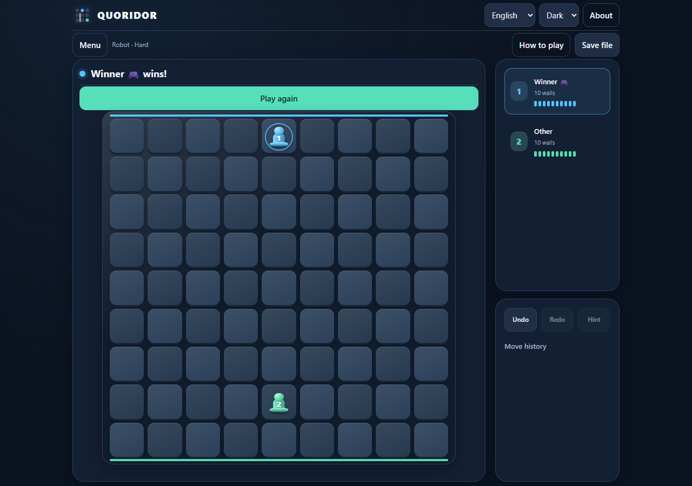](docs/screenshots/web-replay-en-dark.png) |

[شروع دوباره پس از برد در اندروید](docs/screenshots/android-replay-en-dark.png)

### نسخهٔ وب در مرورگر

| فارسی · روشن | English · Dark |
| --- | --- |
| [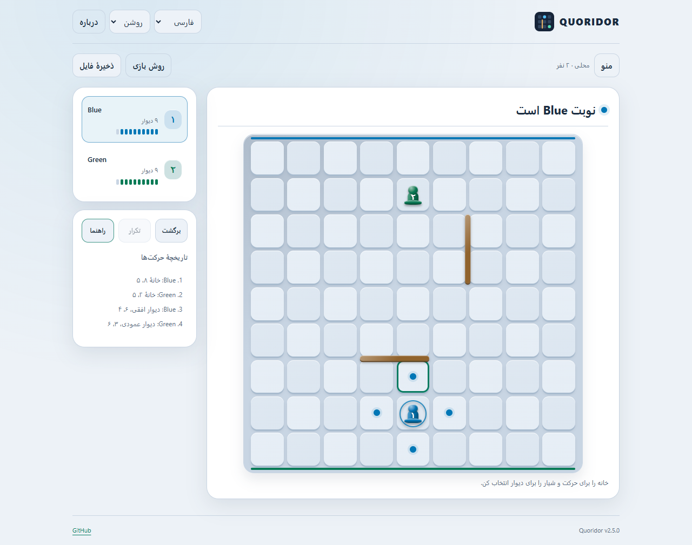](docs/screenshots/web-game-fa-light.png) | [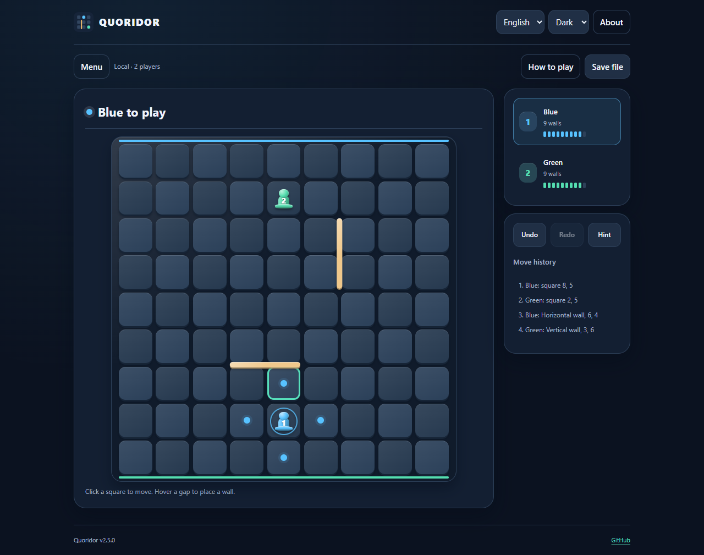](docs/screenshots/web-game-en-dark.png) |

[نمای موبایل بازی چهارنفری](docs/screenshots/web-four-player-mobile.png)

### اندروید، فارسی روشن و انگلیسی تاریک

| فارسی · روشن | English · Dark |
| --- | --- |
| [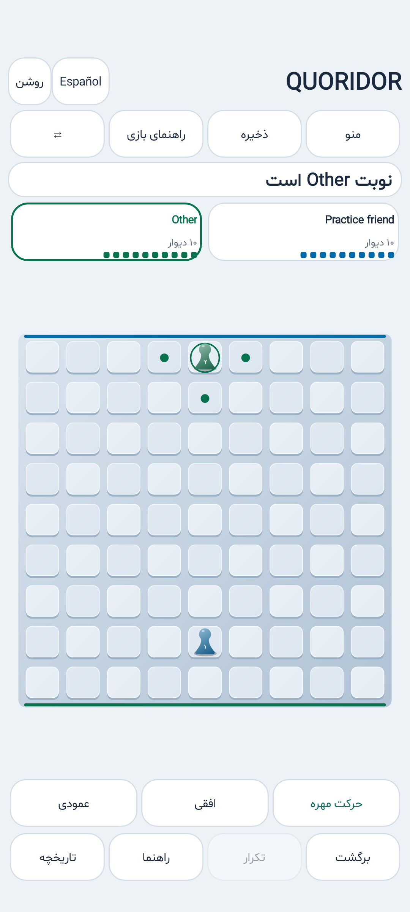](docs/screenshots/android-game-fa-light.png) | [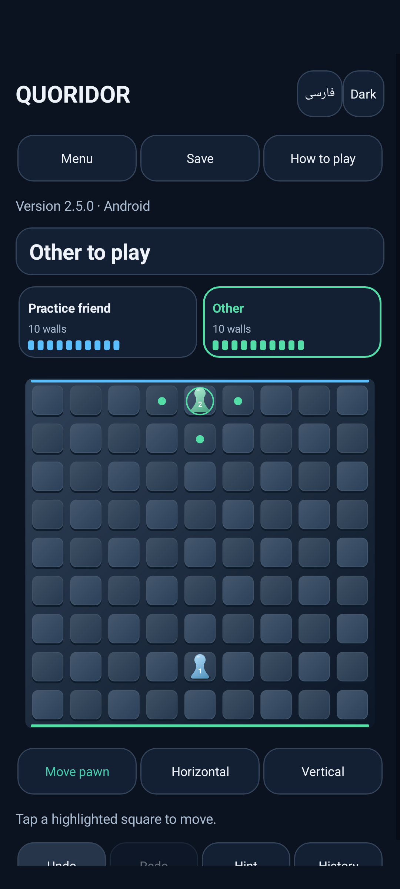](docs/screenshots/android-game-en-dark.png) |

### منوی فارسی با ظاهر روشن

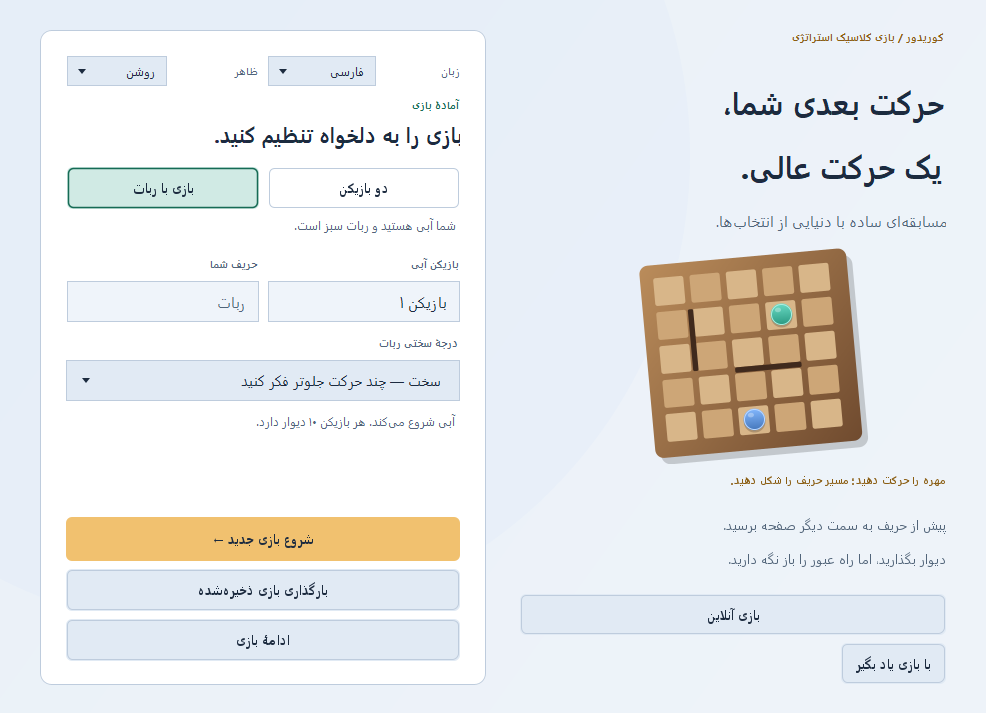

### بازی فارسی با ظاهر روشن

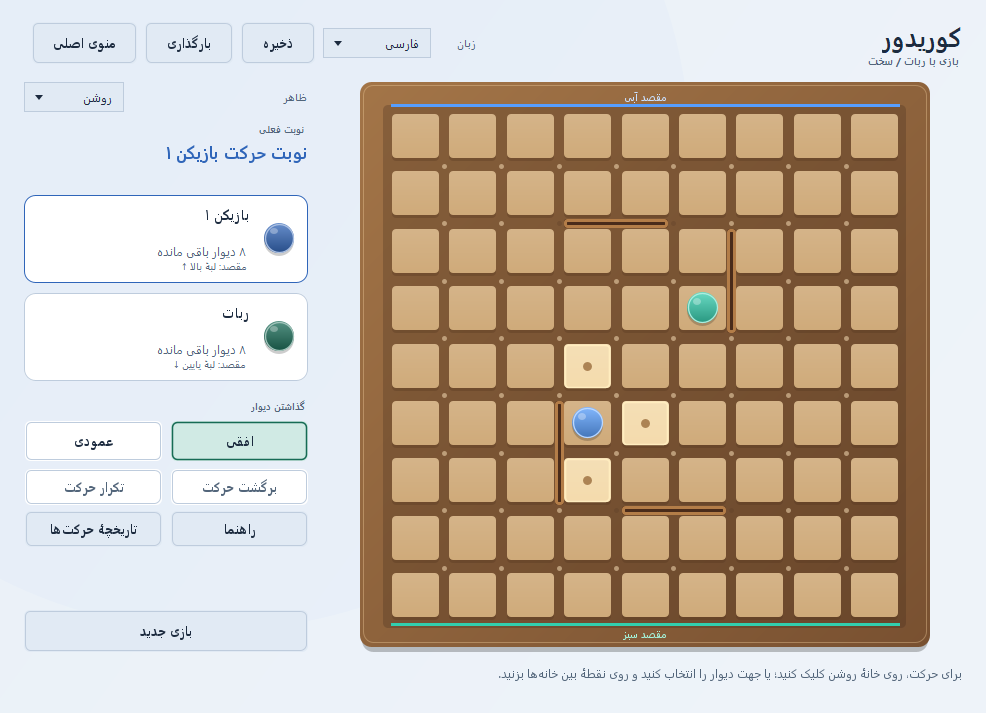

### بازی فارسی با ظاهر تاریک

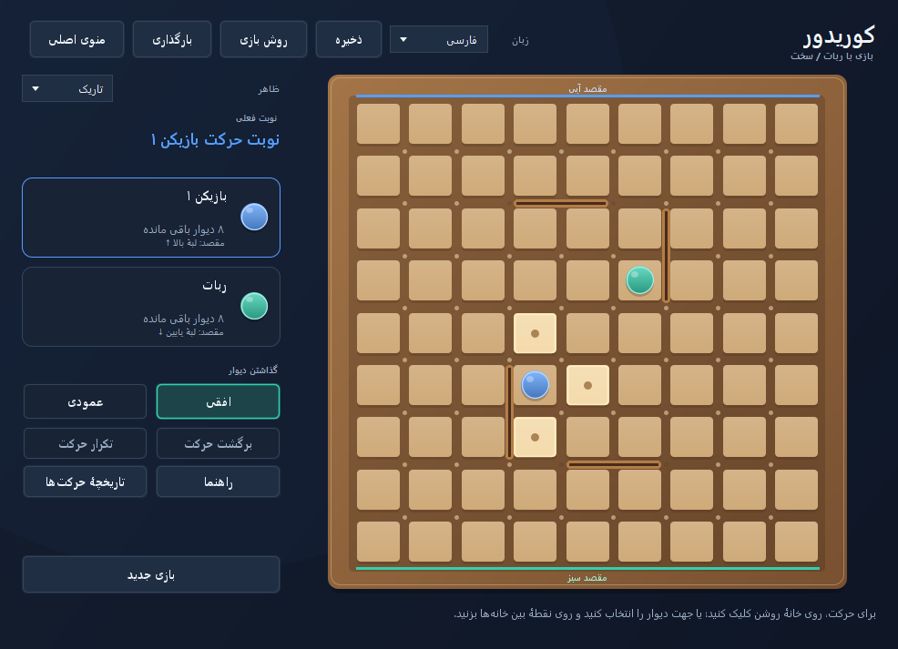

### بازی چهارنفری و آنلاین

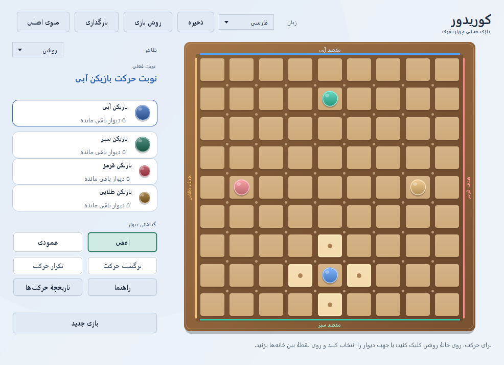

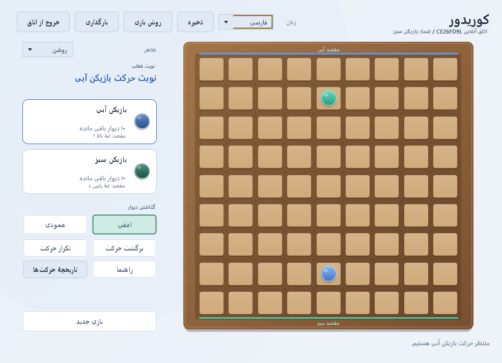

برای بازتولید تصاویر مستندات از اجرای واقعی برنامه، با JDK و دسکتاپ گرافیکی اجرا کنید:

```powershell
powershell -ExecutionPolicy Bypass -File .\capture-screenshots.ps1
```

## امکانات

- پنج تمرین تصویری کوتاه در همهٔ نسخه‌ها؛ آموزش، بازی واقعی و تاریخچهٔ آن را تغییر نمی‌دهد.
- «دوباره بازی کن» کنار نام برنده؛ صفحه و تاریخچه از نو شروع می‌شوند و نام‌ها، تعداد نفرات، حالت و قدرت ربات حفظ می‌شوند.
- بازی **دو و چهارنفری** روی یک رایانه و بازی تک‌نفره مقابل ربات.
- بازی آنلاین دو و چهارنفری در اندروید/دسکتاپ با **اتاق خصوصی، ورود با کد و یافتن حریف تصادفی**.
- اعتبارسنجی حرکت و نوبت در سرور، همگام‌سازی صفحه‌ها و تلاش برای اتصال دوباره پس از قطع کوتاه‌مدت.
- **برگشت و تکرار حرکت** در بازی محلی، برگشت نوبت کامل انسان و ربات، **راهنمای حرکت** و **تاریخچهٔ حرکت‌ها**.
- سه درجهٔ سختی ربات: **آسان، متوسط و سخت**.
- منوی شروع، ورود نام بازیکنان، ادامهٔ بازی متوقف‌شده و شروع بازی جدید.
- ذخیره و بارگذاری بازی با قالب `.qsave` و واردکردن ذخیره‌های متنی سازگار `.G3M` از نسخهٔ قدیمی.
- رابط **فارسی و انگلیسی**؛ فارسی با چیدمان راست‌به‌چپ، اعداد فارسی و پیام‌های ترجمه‌شده.
- تختهٔ مدرن با خانه‌های برجسته، مهره‌های حجم‌دار، دیوارهای واضح و تأکید رنگی روی نوبت؛ کارت بازیکنان وب و اندروید موجودی دیوار را تصویری نشان می‌دهد.
- ظاهر **تاریک و روشن** برای منو، صفحهٔ بازی، پنجره‌های ذخیره و بارگذاری و پیام‌ها.
- نمایش حرکت‌های مجاز، پیش‌نمایش دیوار، شمارش دیوارهای باقی‌مانده و اعلام برنده.

## نسخهٔ وب و GitHub Pages

**[اجرای بازی در مرورگر](https://salehghotbani.github.io/Game-Quoridor/)** شامل بازی محلی دو/چهارنفره، ربات سه‌سطحی، آموزش تصویری، شروع دوباره پس از برد، فارسی/انگلیسی، روشن/تاریک، ذخیره و بارگذاری، بازیابی مرورگر و ابزارهای تاریخچه است. نام‌ها اختیاری‌اند و صفحه‌ها متن کمتری دارند. حرکت و دیوارگذاری مستقیم‌اند: برای پیش‌نمایش روی شیار بروید و با یک کلیک دیوار را بگذارید؛ انتخاب ابزار و تأیید جداگانه لازم نیست. بخش «رقابت از راه دور» و اتصال به نشانی سرور فعلاً از وب حذف شده‌اند؛ اندروید ابزارهای قبلی را حفظ کرده است.

فایل [GitHub Actions](.github/workflows/web.yml) در PRها آزمون‌ها را اجرا می‌کند و پس از push موفق به `main`، سایت را روی Pages منتشر می‌کند. فرمان‌های ساخت/آزمون و راهنمای تعامل مستقیم و آموزش در [WEB.md](WEB.md) آمده‌اند.

نسخهٔ فعلی کد **۲.۷.۱** است. دانلودهای آمادهٔ اندروید و ویندوز زیر مربوط به انتشار بومی **۲.۲.۰** هستند؛ انتشار Pages مستقل از آن‌ها انجام می‌شود.

## نسخهٔ APK اندروید

فایل `Quoridor-2.2.0-android-unsigned.apk` را از [GitHub Releases](https://github.com/salehghotbani/Game-Quoridor/releases) دریافت کنید. **طبق انتخاب صاحب پروژه، این نسخه بدون امضاست و پیش از نصب باید آن را با کلید خودتان امضا کنید.** این فایل قدیمی برای **Android 8.0 و جدیدتر، API 26+** است و به نصب Java نیاز ندارد. بازی محلی دو و چهارنفری، ربات سه‌سطحی، فارسی و انگلیسی، ظاهر روشن و تاریک، ذخیرهٔ سازگار با رایانه و اتاق آنلاین مشترک در دسترس‌اند.

**کد فعلی ۲.۷.۱ از Android 5.0 و جدیدتر، API 21+ پشتیبانی می‌کند**؛ از جمله
Galaxy S5 با اندروید ۵ یا ۶. APK جدید را با دستور زیر بسازید؛ دانلود قدیمی ۲.۲.۰
همچنان اندروید ۸ می‌خواهد. بازی به Google Play Services یا کتابخانهٔ بومی مخصوص
پردازنده نیاز ندارد. اندروید ۴.۴ پشتیبانی نمی‌شود.

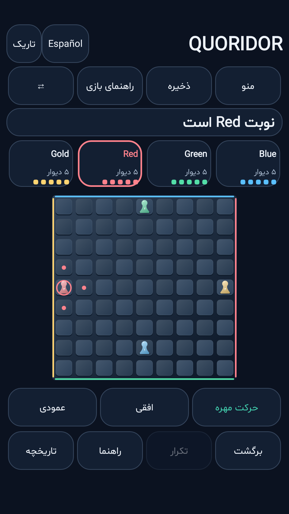

برای دیوارگذاری، ابزار افقی یا عمودی را انتخاب کنید، محل دیوار را لمس و پیش‌نمایش را تأیید کنید. بازی محلی روی دستگاه ذخیرهٔ بازیابی دارد؛ با «ذخیره» فایل qsave را از انتخاب‌گر فایل Android صادر کنید و با «بارگذاری فایل بازی» ذخیرهٔ اندروید یا رایانه را باز کنید. دسترسی گسترده به حافظه لازم نیست.

برای ساخت APK انتشار بدون امضا:

```powershell
powershell -ExecutionPolicy Bypass -File .\build-android.ps1 -Unsigned
```

کلید خصوصی انتشار ساخته نشده است. راهنمای امضای بعدی APK، ساخت اختیاری همراه امضا، پیش‌نیازها، آزمون شبیه‌ساز، اتصال به سرور و محدودیت‌های چرخهٔ اجرای Android در [ANDROID.md](ANDROID.md) آمده‌اند. این پروژه برنامه را در فروشگاه منتشر نمی‌کند.

## نسخهٔ EXE ویندوز

بسته‌های انتشار برای **ویندوز ۶۴بیتی** ساخته می‌شوند و Java را همراه خود دارند؛ برای اجرای آن‌ها نیازی به نصب جداگانهٔ Java نیست.

- **نصب‌کننده:** فایل `Quoridor-2.2.0-windows-x64-setup.exe` را اجرا کنید.
- **نسخهٔ قابل‌حمل:** تمام محتوای `Quoridor-2.2.0-windows-x64.zip` را استخراج کنید و سپس `Quoridor/Quoridor.exe` را باز کنید. فایل EXE باید همراه پوشه‌های `app/` و `runtime/` بماند.
- **نسخهٔ JAR:** فایل `Quoridor-2.2.0.jar` برای محیط دارای Java 17 یا جدیدتر ارائه می‌شود.
- **سرور مستقل:** فایل `Quoridor-2.2.0-server.jar` برای میزبانی اتاق‌ها با Java 17 یا جدیدتر است.

نسخه‌های منتشرشده در [GitHub Releases](https://github.com/salehghotbani/Game-Quoridor/releases) قرار می‌گیرند. برای بررسی فایل‌های دانلودشده از `SHA256SUMS.txt` استفاده کنید.

برای ساخت بسته‌های ویندوز از کد پروژه:

```powershell
powershell -ExecutionPolicy Bypass -File .\build-windows.ps1 -DownloadWix
```

خروجی ساخت کد فعلی در `out/releases/v2.7.1` نوشته می‌شود. جزئیات پیش‌نیازهای ساخت EXE، آزمون بسته، امضای دیجیتال، نسخه‌بندی و آماده‌کردن Release در [RELEASING.md](RELEASING.md) آمده است.

## شروع بازی آنلاین

از منوی اصلی **بازی آنلاین** را بزنید، نشانی سرور مشترک و نام خود را وارد کنید و سپس **ساخت اتاق**، **ورود به اتاق** یا **یافتن حریف** را انتخاب کنید. برای اتاق یا صف جدید، دو یا چهار نفر را انتخاب کنید. با کامل‌شدن نفرات، مسابقه شروع می‌شود.

سرور عمومی از قبل در بازی تنظیم نشده است. برای شبکهٔ محلی، `run-server.ps1` و برای میزبانی اینترنتی، فایل‌های آمادهٔ `Dockerfile` و `render.yaml` وجود دارند. پلن رایگان Render برای شروع قابل استفاده است و محدودیت خواب و راه‌اندازی دوباره دارد. اتاق‌ها در حافظه نگه‌داری می‌شوند. فرمان‌ها، مراحل میزبانی و محدودیت‌ها در [ONLINE.md](ONLINE.md) آمده‌اند.

در بازی چهارنفری هر بازیکن **۵ دیوار** دارد. هدف آبی لبهٔ بالا، سبز لبهٔ پایین، قرمز لبهٔ راست و طلایی لبهٔ چپ است. نوبت‌ها ساعت‌گرد و به ترتیب **آبی ← قرمز ← سبز ← طلایی** هستند. حالت ربات، دونفره باقی می‌ماند.

## پیش‌نیازها

برای ساخت پروژه و استفاده از اسکریپت‌های اجرا و آزمون در ویندوز، **JDK 17 یا جدیدتر** لازم است. فرمان‌های `java`، `javac` و `jar` باید در `PATH` در دسترس باشند. برای اجرای برنامه، محیط دسکتاپ گرافیکی نیز لازم است.

می‌توانید نصب ابزارها را با این فرمان‌ها بررسی کنید:

```powershell
java -version
javac -version
jar --version
```

اگر فایل JAR از قبل ساخته شده باشد، اجرای آن فقط به محیط اجرای **Java 17 یا جدیدتر** و دسکتاپ گرافیکی نیاز دارد.

## دریافت کد پروژه

نسخهٔ فعلی برنامه در شاخهٔ `main` قرار دارد. اگر Git نصب است، پروژه را با این فرمان‌ها دریافت کنید:

```powershell
git clone --branch main https://github.com/salehghotbani/Game-Quoridor.git
Set-Location .\Game-Quoridor
```

## اجرای سریع در ویندوز

PowerShell را در پوشهٔ پروژه باز کنید و اجرا کنید:

```powershell
powershell -ExecutionPolicy Bypass -File .\run.ps1
```

این اسکریپت ابتدا پروژه را می‌سازد و سپس منوی بازی را باز می‌کند.

برای ساخت برنامه بدون بازکردن پنجرهٔ بازی:

```powershell
powershell -ExecutionPolicy Bypass -File .\build.ps1
```

خروجی قابل‌اجرا در مسیر `out/Quoridor.jar` قرار می‌گیرد:

```powershell
java -jar .\out\Quoridor.jar
```

اسکریپت‌ها مسیر پروژه را از محل خودشان پیدا می‌کنند؛ بنابراین می‌توانید آن‌ها را از پوشه‌ای دیگر نیز با مسیر کامل فراخوانی کنید.

شمارهٔ برنامه از فایل `VERSION` خوانده و هنگام ساخت داخل JAR و فایل‌های ویندوز ثبت می‌شود. برای دیدن نسخه بدون بازکردن پنجره:

```powershell
java -jar .\out\Quoridor.jar --version
```

## شروع و ادامهٔ بازی

1. در منوی شروع، **دو بازیکن** یا **بازی با ربات** را انتخاب کنید.
2. نام بازیکن را وارد کنید. در حالت دونفره، نام هر دو بازیکن قابل‌تغییر است. نام‌ها باید بین ۱ تا ۲۴ نویسه باشند.
3. در حالت بازی با ربات، درجهٔ سختی را انتخاب کنید. شما مهرهٔ آبی را کنترل می‌کنید و ربات مهرهٔ سبز را.
4. روی **شروع بازی جدید** کلیک کنید. آبی همیشه شروع می‌کند.

با **منوی اصلی** می‌توانید به منو برگردید و سپس با **ادامهٔ بازی** همان مسابقه را ادامه دهید. **بازی جدید**، مسابقه را با همان بازیکنان و تنظیمات از ابتدا شروع می‌کند. برای تغییر بازیکنان، حالت بازی یا سختی ربات، از تنظیمات منوی شروع استفاده کنید.

برای نگه‌داشتن پیشرفت، پیش از شروع مجدد یا بستن برنامه بازی را ذخیره کنید.

## قوانین و کنترل‌ها

صفحه ۹ × ۹ خانه دارد. آبی از پایین صفحه شروع می‌کند و با رسیدن به هر خانه‌ای از ردیف بالا برنده می‌شود. سبز از بالای صفحه شروع می‌کند و مقصدش ردیف پایین است.

در هر نوبت یکی از این دو کار را انجام دهید:

- **حرکت مهره:** روی یکی از خانه‌های روشن کلیک کنید. حرکت معمول یک خانه در جهت افقی یا عمودی است. اگر حریف در خانهٔ مجاور باشد و خانهٔ پشت او خالی و قابل‌دسترسی باشد، می‌توانید از روی مهره‌اش بپرید. اگر پشت حریف دیوار، لبهٔ صفحه یا مهرهٔ دیگری باشد، حرکت جانبی به خانهٔ خالی مجاز نمایش داده می‌شود. پرش از روی دو مهره با هم مجاز نیست.
- **گذاشتن دیوار:** در ویندوز و وب، نشانگر را روی شیار افقی یا عمودی ببرید تا پیش‌نمایش دیوار دیده شود و با همان کلیک آن را بسازید. انتخاب ابزار یا جهت لازم نیست و حرکت مهره هم‌زمان در دسترس است. در اندروید انتخاب ابزار و تأیید دیوار حفظ شده است. هر دیوار به‌اندازهٔ دو خانه است. هر بازیکن در حالت دونفره ۱۰ دیوار و در حالت چهارنفری ۵ دیوار دارد.

دیوارها نباید روی هم قرار بگیرند یا یکدیگر را قطع کنند. پس از هر دیوارگذاری باید برای همهٔ بازیکنان دست‌کم یک مسیر به مقصد باقی بماند. برنامه حرکت‌ها و دیوارهای نامجاز را رد می‌کند. پس از اعلام برنده، حرکت مهره و دیوارگذاری متوقف می‌شود.

در بازی محلی، **برگشت حرکت** و **تکرار حرکت** وضعیت کامل مهره‌ها و دیوارها را بازیابی می‌کنند. مقابل ربات، نوبت انسان و پاسخ ربات با هم برمی‌گردند. **راهنما** یک حرکت مجاز به سوی هدف را پیشنهاد می‌کند، اما آن را انجام نمی‌دهد. **تاریخچهٔ حرکت‌ها** تا هزار حرکت را به زبان انتخاب‌شده نشان می‌دهد. با بارگذاری یک ذخیره، تاریخچه از همان وضعیت شروع می‌شود.

### درجه‌های سختی ربات

| درجه | رفتار |
| --- | --- |
| آسان | حرکت‌های متنوع برای رقابتی آرام‌تر. |
| متوسط | توجه به مسیرهای کوتاه‌تر و دیوارهای مفید. |
| سخت | بررسی پاسخ‌های تاکتیکی با زمان فکرکردن محدود. |

فکرکردن ربات در پس‌زمینه انجام می‌شود. هنگام نوبت ربات، کنترل حرکت انسان قفل می‌شود و پس از پاسخ ربات دوباره در دسترس قرار می‌گیرد.

## زبان و ظاهر

انتخاب‌گر **زبان** در منو و صفحهٔ بازی فقط دو گزینه دارد: **English** و **فارسی**. اگر زبان سیستم فارسی باشد، برنامه به فارسی باز می‌شود؛ سایر زبان‌های سیستم با رابط انگلیسی شروع می‌شوند.

تغییر زبان، نام بازیکنان، وضعیت مسابقه، دیوارهای ساخته‌شده و نوبت ربات را حفظ می‌کند. راست‌به‌چپ‌شدن رابط فارسی، مختصات صفحه و مقصد بازیکنان را تغییر نمی‌دهد.

از انتخاب‌گر **ظاهر** می‌توانید حالت **تاریک** یا **روشن** را انتخاب کنید. زبان و ظاهر مستقل از یکدیگرند و هر دو ظاهر در هر دو زبان کار می‌کنند. تغییر ظاهر هنگام بازی، مسابقه یا فکرکردن ربات را از ابتدا آغاز نمی‌کند.

ظاهر پیش‌فرض **تاریک** است. انتخاب ظاهر در فایل بازی ذخیره نمی‌شود و پس از بستن و اجرای دوبارهٔ برنامه نیز نگه داشته نمی‌شود.

## ذخیره و بارگذاری

در صفحهٔ بازی روی **ذخیره** کلیک کنید و محل فایل را انتخاب کنید. ذخیره‌های جدید با پسوند `.qsave` نوشته می‌شوند. اگر فایل مقصد وجود داشته باشد، برنامه پیش از جایگزینی آن تأیید می‌گیرد.

فایل ذخیره این اطلاعات را نگه می‌دارد:

- نام بازیکنان، حالت محلی یا ربات، تعداد نفرات و درجهٔ سختی ربات؛
- موقعیت همهٔ مهره‌ها و دیوارهای قرارگرفته؛
- تعداد دیوارهای باقی‌مانده، نوبت بازیکن و برندهٔ احتمالی.

گزینهٔ **بارگذاری** در منوی شروع و صفحهٔ بازی وجود دارد. اگر یک بازی رباتی با نوبت سبز بارگذاری شود، ربات نوبتش را خودکار ادامه می‌دهد. زبان و ظاهر انتخاب‌شدهٔ پنجره پس از بارگذاری حفظ می‌شوند.

ذخیره‌های متنی سازگار `.G3M`، از جمله فایل قدیمی `SaveFile.G3M`، قابل‌واردکردن هستند. واردکردن بازی، فایل قدیمی را تغییر نمی‌دهد؛ برای ادامهٔ ذخیره‌سازی از قالب `.qsave` استفاده کنید.

قالب جدید متنی، دارای نسخه و با کدگذاری UTF-8 است. هنگام بارگذاری، داده‌ها و وضعیت صفحه بررسی می‌شوند؛ فایل نامعتبر جای مسابقهٔ فعلی را نمی‌گیرد. ذخیره‌سازی با نوشتن فایل موقت و جایگزینی اتمی انجام می‌شود؛ اگر این کار ممکن نباشد، ذخیرهٔ قبلی حفظ می‌شود. لغو پنجرهٔ ذخیره یا بارگذاری نیز مسابقه را تغییر نمی‌دهد.

## اجرای آزمون‌ها

برای ساخت پروژه و اجرای همهٔ آزمون‌ها:

```powershell
powershell -ExecutionPolicy Bypass -File .\test.ps1
```

این مجموعه، قوانین حرکت و دیوارگذاری، ربات، ذخیره و بارگذاری، ترجمه‌ها و رابط Swing را بررسی می‌کند. آزمون‌های گرافیکی، پنجره‌ها و پنجره‌های انتخاب فایل را باز و بسته می‌کنند؛ همچنین تغییر زندهٔ زبان و ظاهر، چیدمان راست‌به‌چپ، خوانایی رنگ‌ها و ادامهٔ صحیح نوبت ربات را می‌سنجند. تصاویر آزمون در پوشهٔ `out/` نوشته می‌شوند.

برای اجرای بخش‌های بدون نیاز به نمایشگر:

```powershell
powershell -ExecutionPolicy Bypass -File .\test.ps1 -Headless
```

در این حالت آزمون‌های گرافیکی اجرا نمی‌شوند. خروجی‌های ساخت و آزمون زیر `out/` قرار دارند و در صورت شکست ساخت یا آزمون، اسکریپت با کد خروج غیرصفر پایان می‌یابد. خروجی‌های تولیدشده و فایل‌های شخصی `.qsave` در Git نادیده گرفته می‌شوند.

## ساختار پروژه

```text
src/
  Main.java                 نقطهٔ شروع برنامه
  Board/
    Board.java              منو، صفحهٔ بازی و اجرای نوبت ربات
    GameState.java          قوانین و وضعیت صفحه
    BotPlayer.java          منطق ربات و سه درجهٔ سختی
    GameConfig.java         نام بازیکنان و تنظیمات مسابقه
    GameSession.java        وضعیت و تنظیمات یک مسابقه
    SaveStore.java          ذخیره، بارگذاری و واردکردن قالب قدیمی
    I18n.java               متن‌های فارسی و انگلیسی
    Theme.java              رنگ‌ها و اجزای گرافیکی
  Files/Images/             منابع تصویری برنامه
tests/                      آزمون‌های خودکار و گرافیکی
docs/screenshots/           تصاویر واقعی مستندات
tools/CaptureScreenshots.java  ابزار گرفتن تصاویر مستندات
build.ps1                   ساخت فایل JAR
run.ps1                     ساخت و اجرای برنامه
test.ps1                    اجرای آزمون‌ها
capture-screenshots.ps1      بازتولید تصاویر مستندات
AUTHORS.md                  فهرست توسعه‌دهندگان اولیه
LICENSE                     متن مجوز پروژه
```

## مشارکت در توسعه

راهنمای [CONTRIBUTING.md](CONTRIBUTING.md) محل هر مسئولیت در کد، روش ساخت و آزمون، قواعد کدنویسی، حفظ سازگاری ذخیره‌ها و روند ارسال Pull request را توضیح می‌دهد. برای مرتب‌سازی کدهای Java از `format.ps1` و برای بررسی یکدست‌بودن قالب از `format.ps1 -Check` استفاده کنید.

## توسعه‌دهندگان اولیه

**سه توسعه‌دهندهٔ اولیهٔ پروژه** به شرح زیر هستند. نام‌ها و ترتیب آن‌ها توسط نگه‌دارندهٔ پروژه اعلام شده‌اند و ترتیب، نشان‌دهندهٔ رتبه یا نقش افراد نیست.

| ردیف | نام توسعه‌دهنده |
| --- | --- |
| ۱ | سیدمحمدصالح قطبانی |
| ۲ | محمدجواد بنان |
| ۳ | امیرمحمد خسروی |

اطلاعات تیم اولیه و روش ثبت مشارکت‌کنندگان بعدی در [AUTHORS.md](AUTHORS.md) آمده است. نام‌ها در آن فایل، [README انگلیسی](README.md) و همین فایل یکسان نگه داشته می‌شوند.

## مجوز

این پروژه تحت مجوز [MIT](LICENSE) منتشر می‌شود. متن کامل مجوز در فایل `LICENSE` و اطلاعات سه توسعه‌دهندهٔ اولیه در [AUTHORS.md](AUTHORS.md) قرار دارد.

هنگام ساخت، این اطلاعیه‌ها در مسیرهای `META-INF/LICENSE` و `META-INF/AUTHORS.md` داخل فایل JAR نیز قرار می‌گیرند. پس از هر اصلاح نام‌ها، برنامه دوباره ساخته می‌شود تا اطلاعیهٔ همراه بسته‌ها به‌روز باشد. فایل مجوز به نویسندگان به‌صورت جمعی و به `AUTHORS.md` ارجاع می‌دهد و متن استاندارد MIT حفظ می‌شود.

## امکانات نسخهٔ ۲٫۶

وب و اندروید از فارسی، انگلیسی، اسپانیایی، فرانسوی و عربی پشتیبانی می‌کنند؛ دسکتاپ فارسی و انگلیسی دارد. فونت شبنم داخل هر سه بسته است و از CDN دریافت نمی‌شود.

در بازی محلی اندروید، گزینهٔ «تحویل گوشی» را فعال کنید. بعد از هر حرکت، نام بازیکن بعدی نمایش داده می‌شود و او با «آماده‌ام» بازی را ادامه می‌دهد. دو یا چهار نفر می‌توانند روی همان گوشی بازی کنند؛ مختصات تخته ثابت می‌ماند.

در آنلاین اندروید، فاصلهٔ درخواست‌ها هنگام بی‌تغییری اتاق تا شش ثانیه و پس از خطای شبکه تا سی ثانیه افزایش می‌یابد. در پس‌زمینه درخواست دوره‌ای متوقف است. طرح درآمدزاییِ ظاهری و اختیاری، بدون برتری پولی، در [MONETIZATION.md](MONETIZATION.md) آمده است.

صفحهٔ اصلی بازی در گوشی و تبلت، افقی و عمودی، اسکرول ندارد؛ تخته و کنترل‌ها با اندازهٔ نمایشگر تطبیق پیدا می‌کنند. تاریخچه و پنجره‌های اختیاری جداگانه‌اند.

[Mobile landscape / گوشی افقی](docs/screenshots/web-phone-landscape.png) · [Tablet / تبلت](docs/screenshots/web-tablet.png) · [Pass phone / تحویل گوشی](docs/screenshots/android-pass-phone.png) · [Four players on one phone / چهار نفر روی یک گوشی](docs/screenshots/android-four-player-fa.png)

در ویندوز، «بارگذاری»، «تاریخچهٔ حرکت‌ها» و «بازی جدید» زیر دکمهٔ «بیشتر» قرار دارند تا صفحه خلوت بماند. ذخیره، آموزش، منو، برگشت، تکرار و راهنما مستقیم در دسترس‌اند.

[Desktop secondary controls / گزینه‌های بیشتر ویندوز](docs/screenshots/desktop-more-fa-light.png)
