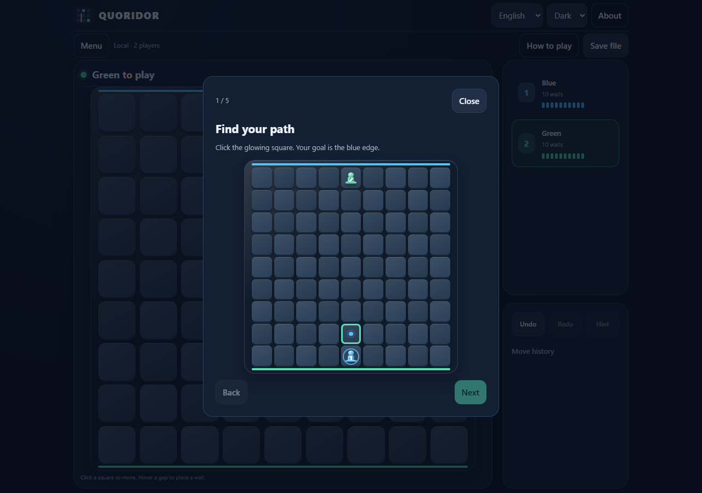
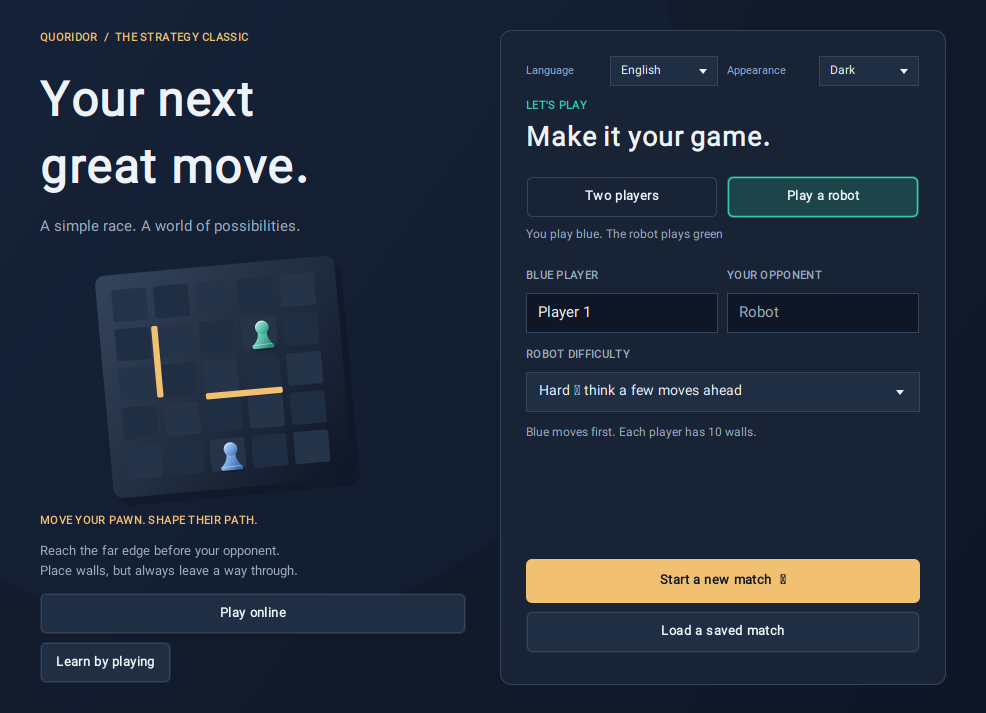
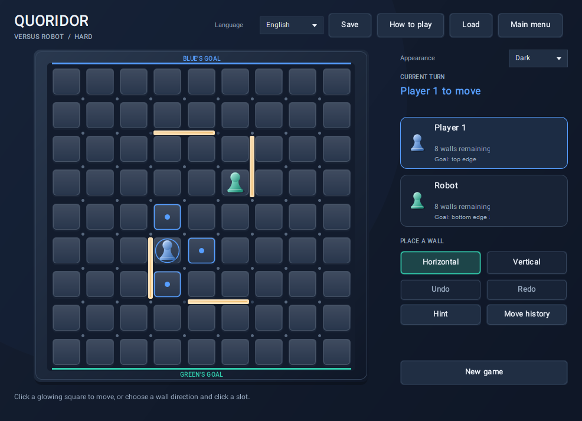
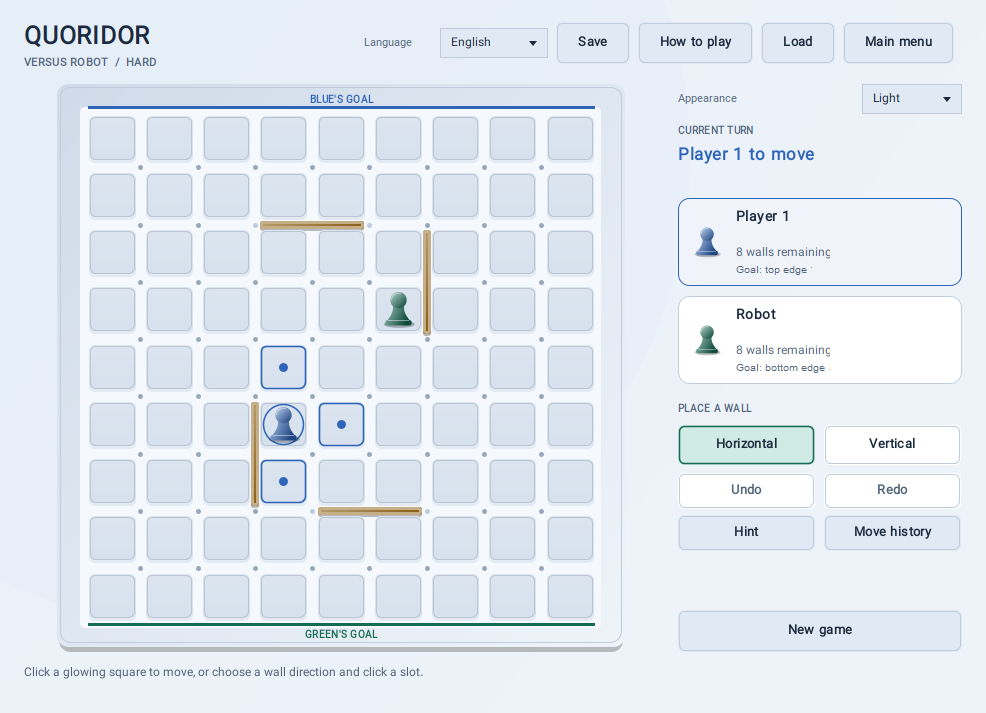

# Quoridor

A strategy game for **web, Android and desktop**. [**Play in your browser →**](https://salehghotbani.github.io/Game-Quoridor/) The browser app runs local matches and robots without installation. Android has a native touch interface; desktop uses Java Swing. Learn through five hands-on visual lessons, then race to the opposite edge of a 9 × 9 board. Place walls to shape opponents' routes and always leave every player a way through. JavaScript rules and portable saves are checked against Java.

Play with **2 or 4 people** locally, or challenge a robot at three difficulty levels. Android/desktop also support private online rooms and random matchmaking; remote-play entry is temporarily removed from the web UI. All editions support **English/Persian**, **dark/light**, save/load and a clear **Play again** action after a local win. Desktop/server use Java's standard library; Android includes API backports and their [notices](THIRD_PARTY_NOTICES.md).

[راهنمای فارسی](README.fa.md) · [Web and GitHub Pages](WEB.md) · [Android guide](ANDROID.md) · [Online play and hosting](ONLINE.md) · [Contributing](CONTRIBUTING.md) · [Releasing](RELEASING.md) · [Changelog](CHANGELOG.md) · [Original development team](#original-development-team) · [MIT license](LICENSE)

## Screenshots

These are actual captures of the application. Each platform's two-player gameplay images show the same legal position in different display settings.

| Visual practice · web | Visual practice · Android |
| --- | --- |
| [](docs/screenshots/web-tutorial-en-dark.png) | [](docs/screenshots/android-tutorial-fa-light.png) |
| **Visual practice · desktop** | **Play again · web** |
| [](docs/screenshots/tutorial-en-dark.png) | [](docs/screenshots/web-replay-en-dark.png) |

[Android winner and replay](docs/screenshots/android-replay-en-dark.png) · [Persian browser tutorial](docs/screenshots/web-tutorial-fa-light.png)

| Web · English · dark | Web · فارسی · روشن |
| --- | --- |
| [](docs/screenshots/web-game-en-dark.png) | [](docs/screenshots/web-game-fa-light.png) |

| Android · English · dark | Android · فارسی · روشن |
| --- | --- |
| [](docs/screenshots/android-game-en-dark.png) | [](docs/screenshots/android-game-fa-light.png) |

| English · dark menu | English · dark game |
| --- | --- |
| [](docs/screenshots/menu-en-dark.png) | [](docs/screenshots/game-en-dark.png) |
| **English · light game** | **فارسی · بازی با ظاهر روشن** |
| [](docs/screenshots/game-en-light.png) | [](docs/screenshots/game-fa-light.png) |
| **Four-player local match** | **Online private match** |
| [](docs/screenshots/four-player-fa-light.png) | [](docs/screenshots/online-fa-light.png) |

## Features

- Web/Android languages: English, Persian, Spanish, French and Arabic. Desktop keeps English/Persian. Persian uses bundled Shabnam, without external font requests.
- Phone/tablet matches use a fixed viewport in both orientations, with no page scrolling. Only optional history/dialog content can scroll.
- Android **Pass phone** mode: enable the optional button in a local match, then hand the phone to the named next player and tap Ready. Supports two/four players on one phone; board coordinates stay fixed.
- Android online idle polling backs off to six seconds; network failures back off to thirty seconds. Background polling stops. See [MONETIZATION.md](MONETIZATION.md) for the proposed cosmetic-only business model.

- A sculpted board with raised tiles, shaded pawns, metallic walls and clear turn highlights in both themes. Web/Android player cards show wall reserves visually.
- Five short visual practice steps on every platform, independent of live games and undo history.
- **Play again** beside a local winner: same names, count, mode and robot strength, fresh board/history.
- Direct web input: hover/focus previews a wall; click its gap to place it. Pawn squares stay available without selecting a tool. Android retains explicit tools and wall confirmation.
- Local **two- and four-player** matches, or a human playing Blue against a Green robot.
- Android/desktop online **two- and four-player** rooms: create a private room, join with a code, or find opponents in the public queue.
- Server-validated moves, turn ownership, synchronized boards, connection retry, and explicit room closure after leaving or expiry.
- **Undo/redo** in local games, paired human/robot turn undo, a suggested legal pawn move, and a localized **move history**.
- **Easy**, **Medium**, and **Hard** robot opponents. Robot thinking runs in the background so the interface remains responsive.
- A start menu with player names, mode and difficulty selection, loading, and resuming a paused match.
- Versioned UTF-8 `.qsave` files that retain player names, game mode, robot difficulty, pawn positions, walls, remaining walls, and the current turn.
- Import of compatible text-based `.G3M` saves from the original application.
- English and Persian text, Persian numbers and a right-to-left layout, with fixed board coordinates in both languages.
- Dark and light colors for the menu, game, tooltips, messages, and save/load dialogs.

## Web and GitHub Pages

**[Play Quoridor in your browser](https://salehghotbani.github.io/Game-Quoridor/)** — local two/four-player games, three robot strengths, visual practice, replay, English/Persian, dark/light, portable `.qsave`, browser recovery, undo/redo, hints and history. The menu has optional names and concise controls. Move or place either wall orientation directly on the board; no tool selector or second confirmation is needed. Server-link remote competition is temporarily removed from this edition.

`build-web.ps1` creates the static site under `out/web/site`; `test-web.ps1` runs Node, Java parity, retained transport/CORS regressions and isolated browser tests. [The Actions workflow](.github/workflows/web.yml) checks pull requests and builds/tests/deploys successful `main` pushes to Pages. See [WEB.md](WEB.md) for setup, direct input and practice.

The current source version is **2.6.0**. Existing Android and Windows downloads below are the published **2.2.0** native release; Pages deploys independently from `main`.

## Android APK

Download `Quoridor-2.2.0-android-unsigned.apk` from [GitHub Releases](https://github.com/salehghotbani/Game-Quoridor/releases). **This release is unsigned at the maintainer's request; sign it with your own Android key before installing.** The app supports **Android 8.0 or newer (API 26+)** and includes the native interface, local two/four-player games, three robot levels, both languages/themes, compatible save files, and online rooms shared with desktop players.

Select a wall tool, tap an intersection to preview the wall, then confirm it. Local matches save a recovery position on this device; use **Save** to export a `.qsave` through Android's document picker. **Load a save file** imports a desktop or Android save without storage permissions.

Build the unsigned release APK from source:

```powershell
powershell -ExecutionPolicy Bypass -File .\build-android.ps1 -Unsigned
```

No release signing key was created. See [ANDROID.md](ANDROID.md) for signing the APK later, optional signing from source, SDK setup, testing, device/LAN addresses and lifecycle limits. No app-store publication is performed by this project.

## Windows EXE packages

Release builds are prepared for **Windows x64** with Java included. Use `Quoridor-2.2.0-windows-x64-setup.exe` for installation, or extract the entire `Quoridor-2.2.0-windows-x64.zip` and run `Quoridor/Quoridor.exe`. Keep the EXE and its `app/` and `runtime/` directories together. The Windows packages do not require Java to be installed separately.

Published builds are listed in [GitHub Releases](https://github.com/salehghotbani/Game-Quoridor/releases). Use the accompanying `SHA256SUMS.txt` to check downloaded files. The optional `Quoridor-2.2.0.jar` requires Java 17 or newer.

To build the Windows packages from source:

```powershell
powershell -ExecutionPolicy Bypass -File .\build-windows.ps1 -DownloadWix
```

Building the current source produces versioned assets under `out/releases/v2.6.0`. See [RELEASING.md](RELEASING.md) for WiX setup, the portable-only option, package validation, signing status, versioning, and preparing a release draft.

## Online play

In Android/desktop, choose **Play online**, enter the shared server address and your name, then **Create match**, **Join match**, or **Find opponents**. Select 2 or 4 players for a new room/queue. The game starts when all seats fill. Everyone must connect to the same server.

There is no preconfigured public service. Run `run-server.ps1` for a local/LAN server, or deploy the included `Dockerfile` and `render.yaml` to a host such as Render. A standalone `Quoridor-2.2.0-server.jar` is also included in release assets. See [ONLINE.md](ONLINE.md) for commands, free-host limitations, connection behavior, and deployment steps. Server/cloud restarts discard rooms held in memory.

## Requirements

| Purpose | Requirement |
| --- | --- |
| Build and test | JDK 17 or newer; `java`, `javac`, and `jar` on `PATH` |
| Run an already built JAR | Java 17 or newer and a graphical desktop |
| Included scripts | Windows PowerShell |
| Windows EXE packaging | Windows x64 JDK with `jpackage` and `jlink`; WiX 3 for the installer |
| Run Android APK | Android 8.0+; no Java installation needed |
| Build Android | JDK 17, Android SDK platform 35/build tools 35.0.0, pinned Gradle wrapper; see [ANDROID.md](ANDROID.md) |

The desktop/server build needs no Maven, Gradle, external JARs, native plugins, or media player installation. The separate Android module uses its pinned Gradle/SDK tools.

## Quick start

The current game is on the `main` branch:

```powershell
git clone --branch main https://github.com/salehghotbani/Game-Quoridor.git
Set-Location Game-Quoridor
powershell -ExecutionPolicy Bypass -File .\run.ps1
```

If you already have this checkout, run the final command from the project directory. `run.ps1` builds the application and starts it.

To build without launching:

```powershell
powershell -ExecutionPolicy Bypass -File .\build.ps1
```

The runnable application is written to `out/Quoridor.jar`:

```powershell
java -jar out/Quoridor.jar
```

The scripts also work when invoked by absolute path from another directory. The JAR includes the project license and author notice under `META-INF`.

The application version comes from `VERSION`. Check the built version without opening a window:

```powershell
java -jar out/Quoridor.jar --version
```

## How to play

For **four players**, select 4 on the local setup screen or online room/queue. Each player has **5 walls**. Blue aims for the top edge, Green for the bottom, Red for the right, and Gold for the left. Turns proceed clockwise: **Blue → Red → Green → Gold**. The robot mode remains a two-player game.

1. Choose **Two players** or **Play a robot** on the start menu. Enter player names; choose a difficulty for a robot match. Select **Start a new match**.
2. Blue starts at the bottom and moves first. Blue wins by reaching any square on the top row; Green aims for the bottom row.
3. Click a highlighted square to move. You may jump an adjacent opponent when the square behind is accessible and empty. A wall, board edge or occupied square behind that opponent permits a legal unoccupied side step instead. You cannot jump over two pawns together.
4. To place a wall, choose **Horizontal** or **Vertical**, then click a slot between squares. Hovering or focusing a slot previews the full wall. In a two-player match each player starts with 10 walls. Walls cannot overlap, cross, or close every route to any player's goal.
5. Use **Main menu** to pause and **Resume your match** to continue. **New game** restarts with the current player names, mode, and difficulty.

Rules follow [Gigamic's official Quoridor instructions](https://export.gigamic.com/wp-content/uploads/2021/01/INS-RULES-QUORIDOR_10-2016.pdf), with Blue always starting in this application.

In local play, **Undo** and **Redo** restore complete positions, including placed walls. Against the robot, they rewind/replay the human-and-robot turn together. **Hint** marks a legal pawn move towards your goal without playing it. **Move history** shows the latest 1,000 moves and translates them in the current language. History starts fresh when loading a saved position.

### Robot difficulty

| Level | Behavior |
| --- | --- |
| Easy | Varied moves for a relaxed match |
| Medium | Efficient routes and useful wall placements |
| Hard | Tactical search with a bounded thinking time |

### Language and appearance

Use **Language** in the menu or game header to choose **English** or **فارسی**. Use **Appearance** in the menu or beside the board to choose **Dark** or **Light**.

Changing either setting keeps the current match, names, selected wall direction, and pending robot turn intact. Persian uses a right-to-left interface; rows, columns, goals, and movement retain the same meaning. The only interface languages offered are English and Persian.

On launch, a Persian system locale selects Persian; other system locales select English. Appearance starts in Dark mode. Display settings are per window and are not stored in saved matches or remembered between launches.

## Save and load

Select **Save** during a match to write a `.qsave` file. Use **Load** in the game header or **Load a saved match** on the start menu to reopen one. A loaded robot turn continues automatically.

The loader validates saved positions and retains the current match if loading fails. Saves use an atomic replacement: an existing file is kept if a complete atomic write cannot be made. Invalid files and save errors produce a message in the chosen language.

Compatible old text `.G3M` files, including the original `SaveFile.G3M` fixture, can be imported. New saves use `.qsave`.

## Build verification and tests

```powershell
powershell -ExecutionPolicy Bypass -File .\test.ps1
```

This rebuilds the JAR, compiles the tests, and checks two/four-player rules, all robot levels, saves, history, HTTP authority/concurrency/timeouts, matchmaking, reconnect/cancellation and translation coverage. Graphical tests cover both languages/themes, actual rendered contrast, save/load dialogs, local tools and multiple synchronized online windows. They briefly open windows and write screenshots under `out`.

For a machine without a graphical display:

```powershell
powershell -ExecutionPolicy Bypass -File .\test.ps1 -Headless
```

Any build or test failure returns a nonzero exit code. Generated files and personal `.qsave` files are ignored by Git.

### Refresh the documentation screenshots

```powershell
powershell -ExecutionPolicy Bypass -File .\capture-screenshots.ps1
```

This builds the current application and captures its real Swing interface into `docs/screenshots`. It requires a graphical desktop and does not replace personal saved games.

## Project layout

```text
src/Main.java                    Application entry point
src/Board/                       Rules, robot, saves, localization, and interface
src/Online/                      HTTP client, room server, protocol and matchmaking
src/Files/Images/                Application icon
tests/                          Rule and Swing integration tests
tools/CaptureScreenshots.java    Documentation screenshot capture utility
docs/screenshots/                Tracked README screenshots
build.ps1 / run.ps1 / test.ps1    Build, launch, and verification scripts
capture-screenshots.ps1          Refresh the README screenshots
AUTHORS.md                       Original development team and credit instructions
CONTRIBUTING.md                  Development workflow and coding conventions
RELEASING.md                     Windows packaging, versioning and release workflow
VERSION / CHANGELOG.md           Current version and application history
build-windows.ps1                Native Windows launcher and installer packages
build-server.ps1 / run-server.ps1 Build and launch the standalone room server
Dockerfile / render.yaml         Server deployment templates
ONLINE.md                        Local/LAN/Internet play and hosting guide
LICENSE                          MIT license
```

## Contributing

See [CONTRIBUTING.md](CONTRIBUTING.md) for the architecture map, development setup, coding conventions, formatting, tests, saved-game compatibility, and pull request workflow. Run `format.ps1` to apply the pinned Java formatter, or `format.ps1 -Check` to verify the style.

## Original development team

This software project was originally developed by the following **three people**. Names are shown as supplied by the project maintainer; the order does not assign a role or ranking.

| Original developer | Full name |
| --- | --- |
| 1 | سیدمحمدصالح قطبانی |
| 2 | محمدجواد بنان |
| 3 | امیرمحمد خسروی |

See [AUTHORS.md](AUTHORS.md) for original-team attribution, optional profile links and later contributor credits. Keep the names consistent with the team table in [README.fa.md](README.fa.md).

## License

The source code and documentation are released under the [MIT license](LICENSE). Keep the copyright and license notices when redistributing them. The copyright notice refers to **The Quoridor Authors**, whose names are recorded in [AUTHORS.md](AUTHORS.md).

The MIT license text follows the [Open Source Initiative's published MIT license](https://opensource.org/license/mit).

[Mobile landscape / گوشی افقی](docs/screenshots/web-phone-landscape.png) · [Tablet / تبلت](docs/screenshots/web-tablet.png) · [Pass phone / تحویل گوشی](docs/screenshots/android-pass-phone.png) · [Four players on one phone / چهار نفر روی یک گوشی](docs/screenshots/android-four-player-fa.png)
